<!-- Cabeçalho -->

  

  

## 👋 Seja bem-vindo!

- 🔧 Foco em **Engenharia de Dados**: pipelines ETL/ELT, orquestração e modelagem de dados
- 🤖 Explorando **IA e Machine Learning**: modelos preditivos, LLMs e RAG
- ☁️ Trabalhando com **cloud** e infraestrutura para dados
- 📫 Fale comigo pelo [LinkedIn](https://www.linkedin.com/in/lucas-le%C3%A3o-615848308) ou por [e-mail](https://mail.google.com/mail/?view=cm&fs=1&to=lucas99br@gmail.com)

  

## 🛠️ Tecnologias

### 🐍 Linguagens & Bancos de Dados

  &nbsp;
  &nbsp;
  &nbsp;
  &nbsp;
  &nbsp;
  &nbsp;
  

### 🔄 Engenharia de Dados

  &nbsp;
  &nbsp;
  &nbsp;
  

### 🤖 IA & Machine Learning

  &nbsp;
  &nbsp;
  &nbsp;
  &nbsp;
  &nbsp;
  &nbsp;
  &nbsp;
  &nbsp;
  

### ☁️ Cloud & DevOps

  &nbsp;
  &nbsp;
  &nbsp;
  &nbsp;
  &nbsp;
  &nbsp;
  &nbsp;
  

## 📊 Estatísticas

  
  

  

## 📫 Contato

  
  

<!-- A animação é gerada pelo workflow .github/workflows/snake.yml no branch "output" -->
<picture>
  <source media="(prefers-color-scheme: dark)" srcset="https://raw.githubusercontent.com/LucasLeao16/LucasLeao16/output/github-contribution-grid-snake-dark.svg">
  <source media="(prefers-color-scheme: light)" srcset="https://raw.githubusercontent.com/LucasLeao16/LucasLeao16/output/github-contribution-grid-snake.svg">
  
</picture>
